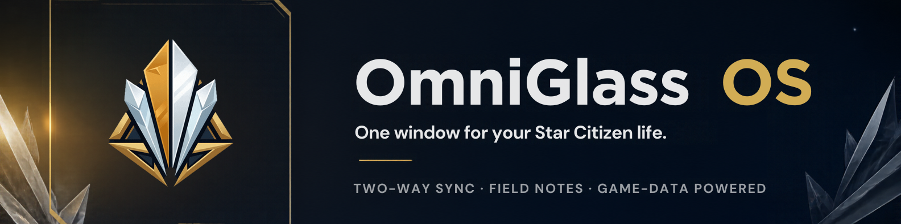
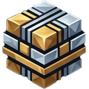
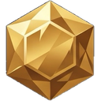
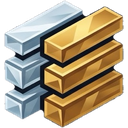

 

**A Star Citizen companion built by a player, for players.**
A passion project: made in spare time, shaped by how we actually play, and free to use.

 

<h2></h2>

I was tired of a browser full of tabs (UEX, Erkul, the Star Citizen wiki, VerseTime and more) sitting next to separate desktop apps like Smart Citizen and Star String. I wanted **one place** that brings together everything useful that Star Citizen and CIG's rules allow, with a **two-way sync** between the app and the website, plus the standout features that set it apart.

This repository holds the **Windows installers** and the **update manifest** (`latest.json`) for **OmniGlass OS™**, the desktop app. The companion website is [omniglass.org](https://omniglass.org).

 

<h2></h2>

<table>
  <tr>
    <td width="96" align="center"></td>
    <td>
      <h3>Two-way sync with omniglass.org</h3>
      Blueprints you own (they only ever get added), your reputation ranks (the newest choice wins) and your wishlist stay in step between the app and your profile on the site.
    </td>
  </tr>
  <tr>
    <td width="96" align="center"></td>
    <td>
      <h3>Field Notes: the game's own screens, made smarter</h3>
      A text layer adds blueprint marks to contracts (new, or already owned), mission details such as rank, <code>ILLEGAL</code>, <code>CHAIN</code> and <code>ONCE ONLY</code> flags and reputation per faction, and handheld weapon stats. Linked to your profile, it stays on and updates itself as your data changes; unlinked, it's yours to switch on, with a preview first. Either way it can be rolled back.
    </td>
  </tr>
  <tr>
    <td width="96" align="center"></td>
    <td>
      <h3>Data from the game itself</h3>
      Blueprint, faction, reputation and mineral data is read from your own <code>Data.p4k</code> for <b>LIVE</b> and <b>PTU</b>, so it follows the patch instead of waiting on a wiki.
    </td>
  </tr>
  <tr>
    <td width="96" align="center"></td>
    <td>
      <h3>Reputation by faction ladder</h3>
      Pick your rank per ladder and see what comes next, with a filter for the ranks that unlock blueprints.
    </td>
  </tr>
  <tr>
    <td width="96" align="center"></td>
    <td>
      <h3>In-game HUD: an overlay that watches for you</h3>
      A transparent, always-on-top layer over Star Citizen that never takes a click or a key from the game. Turn it on from the top bar (<b>In-game HUD</b>) or with <b>F6</b>. It is made of cards you place yourself:
      <ul>
        <li><b>Event feed and alerts:</b> blueprints received, contracts, missions, kills, ship losses and flagged shards, as they happen.</li>
        <li><b>Watching:</b> blueprints and minerals you pin, with whether you can take the contract that rewards them.</li>
        <li><b>Session ledger:</b> what happened since the game started, with aUEC earned.</li>
        <li><b>Timers:</b> refinery jobs, Contested Zone keycards and vault doors, plus the ones you start on omniglass.org. A chirp sounds when one is almost done.</li>
        <li><b>Squad &amp; pins:</b> your wingmen, whether they are on your shard, and your saved location pins.</li>
        <li><b>Supply Run:</b> your shopping list, grouped by shop, with the aUEC still to spend.</li>
      </ul>
      <b>F7</b> moves and resizes the cards (one saved layout for flying, one for on foot). <b>F8</b> searches without leaving the game. <b>F5</b> brings the OmniGlass window up. Works with one monitor.
    </td>
  </tr>
  <tr>
    <td width="96" align="center"></td>
    <td>
      <h3>OmniOps web, built in</h3>
      Flip between three views in the same window: <b>In-game HUD</b>, <b>Local engine</b> (your events, blueprints, minerals and reputation) and <b>OmniOps web</b>, the whole of omniglass.org running inside the app. Loadouts, item finder, trade routes, hauling and the rest are there without opening a browser, and the app hands the page your local data, such as the shopping list for Supply Run.
    </td>
  </tr>
  <tr>
    <td width="96" align="center"></td>
    <td>
      <h3>Live sync with scmdb (optional)</h3>
      Blueprints you mark there are added to your list automatically. Off by default.
    </td>
  </tr>
  <tr>
    <td width="96" align="center"></td>
    <td>
      <h3>A log you can read</h3>
      <code>Game.log</code> becomes a timeline: blueprints received, contracts accepted, missions ended and your own ship losses, with readable ship names.
    </td>
  </tr>
</table>

 

<h2></h2>

> [!IMPORTANT]
> OmniGlass is built to stay inside the rules of the game.

| | |
|---|---|
| 🚫 | Never reads game memory and never sends input to the game. |
| 📝 | The only game files it can change are the Field Notes text (`global.ini` and the language line in `user.cfg`), and only with the game closed. It refuses to write while Star Citizen is running, and it can be rolled back. |
| 🕶️ | Never sends other players' names anywhere. PvP opponents show as **Player**. |
| 🔐 | Your profile link and token are never included in settings backups. |

 

<!-- latest-release:start -->
## Latest release: 1.4.4 (2026-11-25)

OmniOps web works again, and the window opens at a size where its buttons show.

### OmniOps web
- Fixed the cause of OmniOps web opening in a separate window and then freezing the app. Since 1.4.1 the app window, overlay and website window all ran WebView2 with the same startup settings, but the in-window web view did not, and WebView2 refuses a view whose settings differ. It now uses the same settings.

### Window
- OmniGlass opens centred at a wider size (1100 × 740) and cannot be made narrower than 860 pixels, so the whole top bar and the minimise, maximise and close buttons are always on screen. On a narrow window the title and shard chip give way first.

[All releases and downloads](../../releases)
<!-- latest-release:end -->

 

<h2></h2>

1. Open the [latest release](../../releases/latest) and download **`OmniGlass-OS-<version>-x64-setup.exe`**.
2. Compare its SHA-256 with the value in `SHA256SUMS.txt`.
3. Run the installer. The app updates itself from `latest.json` in each release.

> [!NOTE]
> The installer is not yet code-signed, so Windows SmartScreen may warn you. Choose **More info → Run anyway** if the checksum matches.

 

FinTac OmniGlass™, OmniGlass OS™ and OmniGlass Prism™ are trademarks of Belpire Interactive. All rights reserved. The ™ symbol marks unregistered trademarks claimed by Belpire Interactive.

Thanks to the Smart Citizen project, whose public feature list helped guide what a companion app can do. No code was copied.

Mission data and payout estimates on omniglass.org (TacBoard mission search, Contract rewards) come from <a href="https://sccraftlab.com/missions">SC Crafting Lab</a> by Percewall. Thank you. Trade prices and distances come from <a href="https://uexcorp.space">UEX</a>; ship, item and picture data from the <a href="https://starcitizen.tools">Star Citizen Wiki</a>.

<a href="https://omniglass.org/privacy.html">Privacy policy</a> · <a href="https://omniglass.org/terms.html">Terms of use</a>

OmniGlass is an unofficial Star Citizen fan project. It is not affiliated with, endorsed by or sponsored by Cloud Imperium Games or Roberts Space Industries. Star Citizen®, Roberts Space Industries® and Cloud Imperium® are registered trademarks of Cloud Imperium Rights LLC and Cloud Imperium Rights Ltd. All game content and materials are the property of their respective owners.

